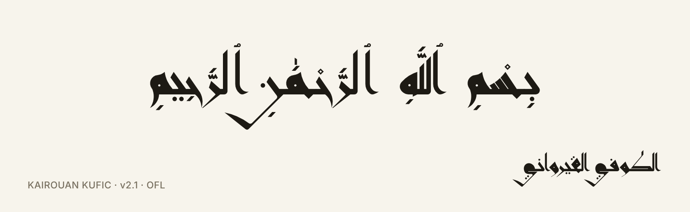
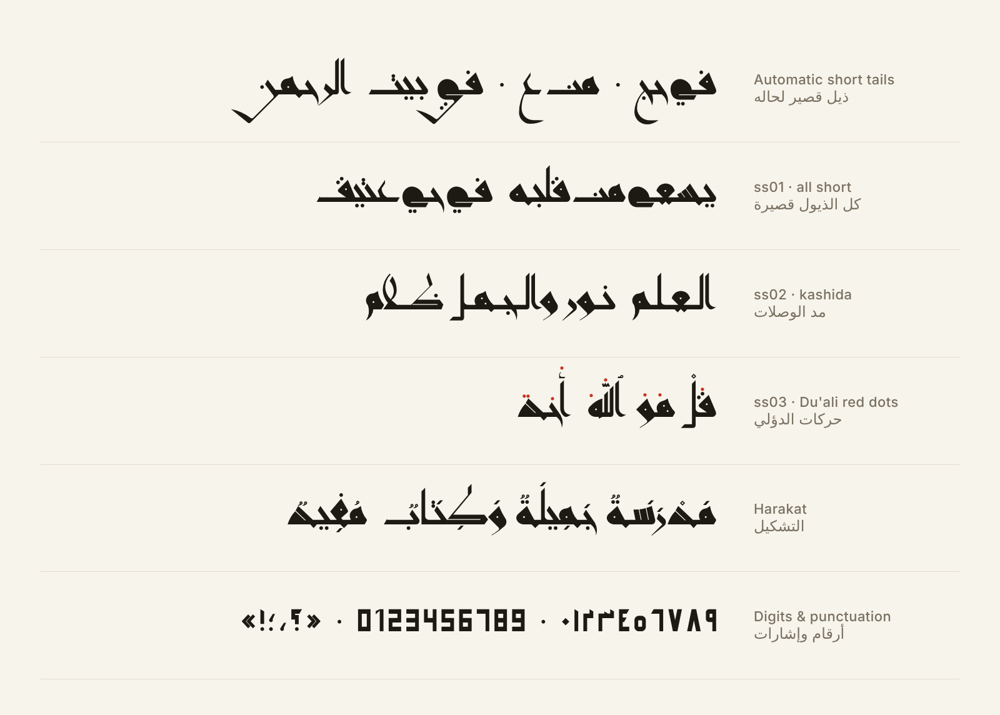
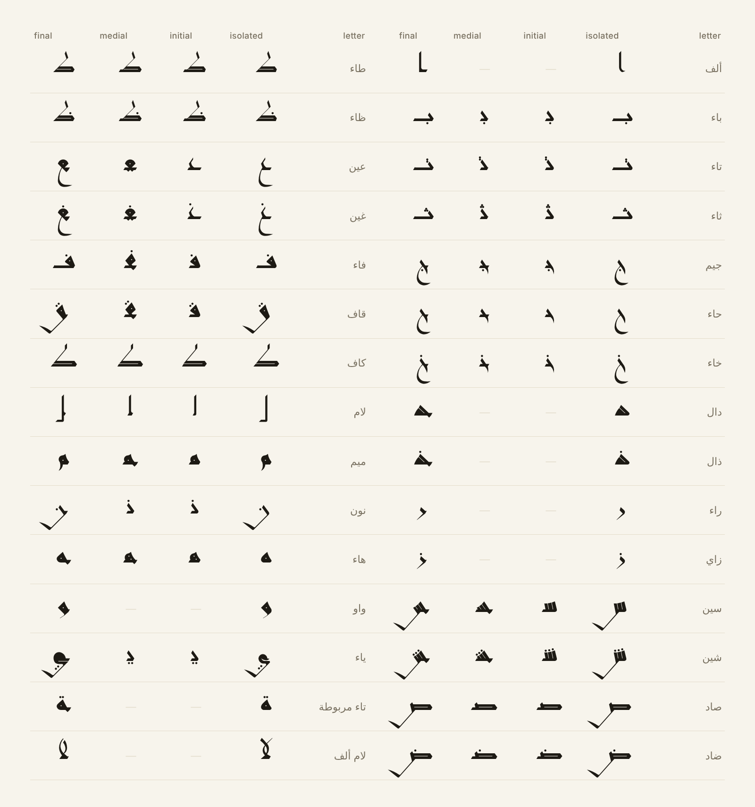
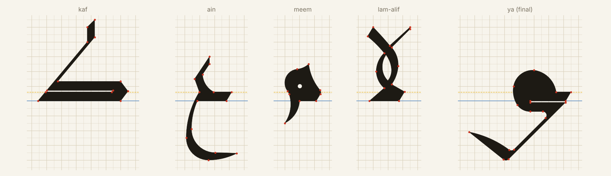

<p align="center">
  
</p>

<h1 align="center">Kairouan Kufic · الكوفي القيرواني</h1>

<p align="center">
  An Arabic Kufic typeface built on the nuqta grid of the Kairouan school.<br>
  <a href="fonts/ttf/KairouanKufic-Regular.ttf"><b>Download TTF</b></a> ·
  <a href="fonts/webfonts/">Web fonts</a> ·
  <a href="docs/index.html">Tester</a> ·
  <a href="OFL.txt">License (OFL 1.1)</a>
</p>

<p align="center">
  
  
  
</p>

<div dir="rtl">

**الكوفي القيرواني** خط عربي كوفي مبني على قواعد كتاب «قواعد الخط الكوفي القيرواني» لعامر بن جدو. **النقطة** هي وحدة القياس، وكل حرف مرسوم بخطوط مستقيمة وأقواس حقيقية، وأطراف الحروف مقطوعة بزاوية القلم 60°. الحروف رُسمت وضُبطت يدوياً بالأوتوكاد على شبكة النقاط، والخط بيتبنى مباشرة من ملف الأوتوكاد.

الخط **مجاني** برخصة SIL Open Font License 1.1، وفيك تستعمله بأي شغل، حتى الشغل التجاري.

</div>

**Kairouan Kufic** is a free Arabic Kufic typeface following the construction rules of Amer Ben Jeddou's *Qawāʿid al-Khaṭṭ al-Kūfī al-Qayrawānī*. The unit is the **nuqta** (the rhombic dot of the grid); every letter is made of straight lines and true arcs, with stroke ends cut at the 60° pen angle. The letters are drawn in AutoCAD on the nuqta grid, and the font is built straight from that drawing.

---

## Specimen

<p align="center"></p>

<p align="center"></p>

## Construction · البناء على شبكة النقاط

<p align="center"></p>

| | nuqta | font units (UPM 1400) |
|---|---|---|
| 1 nuqta (grid unit) | 1 | 196 |
| Pen width W | 5/7 | 140 |
| Vertical stroke V = 5/7 W | 25/49 | 100 |
| Horizontal stroke / join band H = 6/7 W | 30/49 | 120 |
| Gap / hairline G = 1/7 W | 5/49 | 20 |
| Alif height | 5 | 980 |
| Line spacing | 6.5 | 1274 |

Red points: the construction vertices drawn on the grid. Blue: baseline. Dashed: band height H, where every join meets.

## Features

| Feature | What it does |
|---|---|
| `init` `medi` `fina` | Positional forms for every joining letter |
| `rlig` | Lam-alif ligatures: لا لأ لإ لآ |
| `liga` | **Allah** ligature: الله · ٱللَّه · لله (also U+FDF2 ﷲ) |
| `calt` | **Automatic short tails**: a long tail (ي ن ق س ص) goes under the next word, and turns short only where it would touch it. Also moves the dots of ت ث ق away from a following tall letter |
| `ss01` | All tails short |
| `ss02` | Kashida: every join 1 nuqta longer |
| `jalt` | Justification alternates (+1, +2, +3 nuqta) for InDesign / Word |
| `ss03` | **Du'ali vowel dots**: harakat as the red dots of the early Kairouan manuscripts (colour font, `COLR`; black where colour is not supported) |
| `kern` | Pair spacing measured on the outlines: tails reach under the next word; ر ز و ا د ذ ة لا pull the following letter in |
| `mark` `mkmk` | Harakat above and below, stacked on shadda / hamza / small alif, per letter on the Allah ligature |

**Character set:** the Arabic alphabet with hamza forms, alef wasla ٱ, superscript alef ٰ, all harakat and tanween, Arabic-Indic ٠–٩ and Western 0–9 digits, Arabic and Latin punctuation (، ؛ ؟ ! : ( ) « » - – — / ٪ % · ' " ‘ ’ “ ” + =), tatweel, and the Arabic presentation forms (U+FE70–FEFC) for text copied from old PDFs.

## Install

- **Windows:** right-click `fonts/ttf/KairouanKufic-Regular.ttf` → *Install*.
- **macOS:** double-click the file → *Install Font*.
- **Linux:** copy it to `~/.local/share/fonts/` and run `fc-cache -f`.

## Use on the web

```html
<link rel="stylesheet" href="fonts/webfonts/kairouan-kufic.css">
<p class="kufi">بسم الله الرحمن الرحيم</p>
<p class="kufi kufi-duali">بِسْمِ ٱللَّهِ ٱلرَّحْمَٰنِ ٱلرَّحِيمِ</p>
```

| Class | Effect |
|---|---|
| `kufi` | The font, right-to-left, line height for the long tails |
| `kufi-short` | `ss01`: all tails short |
| `kufi-mashq` | `ss02`: kashida on every join |
| `kufi-duali` | `ss03`: Du'ali red vowel dots |
| `kufi-plain` | Write الله letter by letter |

Or directly: `font-feature-settings: "ss01" 1, "ss02" 1, "ss03" 1;`

**In design apps:** the stylistic sets are in the OpenType panel of Illustrator, InDesign and Photoshop (*Stylistic Sets*), and every alternate is in the Glyphs panel. Kashida: type `ـ` (tatweel) wherever you want a longer join.

## Build from the AutoCAD master

The font is generated from [`sources/master/kufic_master.dwg`](sources/master/). See [`tools/README.md`](tools/README.md) for the full guide.

```bash
cd tools
pip install fonttools shapely uharfbuzz brotli ttfautohint-py ezdxf pillow numpy scipy
KUFI_DWG=../sources/master/kufic_master.json python3 kufi/build_font.py ../out/KairouanKufic.ttf
python3 release.py ../out/KairouanKufic.ttf 2.100 ../out
```

## Repository

```
fonts/ttf/            KairouanKufic-Regular.ttf
fonts/webfonts/       WOFF2, WOFF, kairouan-kufic.css
docs/index.html       interactive tester (works offline)
docs/images/          specimen images
sources/master/       AutoCAD master (DWG), pre-read JSON, digits & punctuation cells (DXF)
tools/                build pipeline (Python): master reader, font builder, spacing, checks
OFL.txt               license
```

## Credits

- **Design:** Momen (مؤمن), 2026.
- **Construction rules:** Amer Ben Jeddou, *قواعد الخط الكوفي القيرواني*.
- **Vowel dots:** after the system of Abu al-Aswad al-Du'ali, as written in the Kairouan Qur'ans.
- Built with [fontTools](https://github.com/fonttools/fonttools), [HarfBuzz](https://github.com/harfbuzz/harfbuzz), [Shapely](https://github.com/shapely/shapely), [ttfautohint](https://freetype.org/ttfautohint/) and [LibreDWG](https://www.gnu.org/software/libredwg/).

## License

Copyright 2026 Momen, with Reserved Font Names "Kairouan Kufic" and "الكوفي القيرواني".
This Font Software is licensed under the [SIL Open Font License, Version 1.1](OFL.txt): free to use, study, modify and share, including commercially; not to be sold by itself; modified versions must use a different name.
